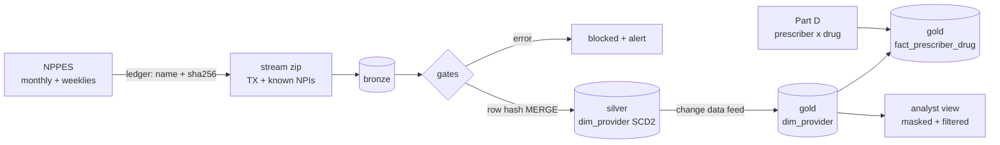

# 113 Provider lakehouse

A Delta Lake medallion pipeline on the real NPPES provider registry. It keeps a full history of every Texas provider (SCD Type 2) from the monthly full file plus the weekly change files, and joins Medicare Part D prescribing to the provider as they were at the end of each claim year.

It runs locally on pip `delta-spark`, and there's a Databricks Asset Bundle and Unity Catalog SQL for running it on Databricks.



## Data

All real, all public, downloaded by the pipeline.

* [NPPES Downloadable File V2](https://download.cms.gov/nppes/NPI_Files.html), the November 2026 monthly full file (1.13 GB zip, 11.8 GB csv, 9.9M NPIs) and the weekly files for Nov 2 to 8 and Nov 9 to 15.
* [Medicare Part D Prescribers by Provider and Drug](https://data.cms.gov/provider-summary-by-type-of-service/medicare-part-d-prescribers/medicare-part-d-prescribers-by-provider-and-drug), data years 2023 and 2024 (3.9 and 4.1 GB csv).
* [NUCC Health Care Provider Taxonomy](https://www.nucc.org/index.php/code-sets-mainmenu-41/provider-taxonomy-mainmenu-40/csv-mainmenu-57) code set 26.1, for the taxonomy gate and specialty names.

The big files are never stored whole. The monthly csv is streamed out of the zip and the Part D files are streamed over HTTP, keeping only Texas rows plus any NPI already in the dimension.

## What it does

1. **Ledger.** Every file is keyed by name and sha256 in `ops.load_ledger`. Loaded already means skipped. Same name with a different checksum is refused and alerted.
2. **Land.** Stream the csv, keep rows in scope, write a gzip subset and a manifest. The subset is also the archive, since NPPES removes old files from its page.
3. **Bronze.** All 330 columns as text, one partition per source file.
4. **Gates.** Header contract, NPI check digit, duplicate NPIs, weekly continuity, quarantine rate, taxonomy and state codes. ERROR blocks the merge, WARN loads and alerts. Bad rows go to quarantine with a reason.
5. **Silver.** Each row is hashed and classified against the current version (new, changed, deactivated, same day fix, unchanged, stale), then one MERGE closes and opens versions.
6. **Gold.** The provider dimension follows silver through the Change Data Feed. Part D facts point at the provider version valid on Dec 31 of the claim year.
7. **Access.** Analysts see only granted states, with street address, phone and full ZIP masked for individual providers.

Decisions, the checks table, failure modes, SLA and cost are in [docs/design.md](docs/design.md).

## Results

Real run on Nov 18, 2026, Apple M2 with 8 GB, Texas scope.

| | |
|---|---|
| NPPES rows streamed / kept | 9,891,116 monthly + 31,562 and 29,288 weekly / 651,375 + 2,551 + 2,427 |
| Providers in the dimension | 653,089 NPIs, 655,338 versions (2,219 with a second version, 30 with a third) |
| Week 1 / week 2 | 772 / 946 new, 1,009 / 1,145 changed, 43 / 52 deactivated, 727 / 284 unchanged |
| Most changed fields | practice address (1,138), practice ZIP (1,114), mailing address (1,060), taxonomy list (846) |
| Rerun of a loaded week | skipped by the ledger, no Delta commit |
| Backfill since Nov 8 vs incremental | 655,338 rows each side, 0 different |
| Full rebuild vs incremental | dimension and 3,677,110 fact rows, 0 different, 331s |
| Live NPPES API spot check | 296 of 296 matched on every field (4 skipped as updated after my last weekly) |
| Part D facts, 2023 / 2024 | 1,792,881 / 1,884,229 rows, $14.87B / $15.75B, 72,735 / 75,623 prescribers |
| Prescribers matched to their version as of Dec 31 | 67.5% for 2023, 75.5% for 2024 |
| Time | 182s to stream the monthly, 136s to load it, about a minute per weekly |

The unchanged rows were the interesting part. In week 1, 465 of the 727 were providers updated on Nov 2, the day the monthly and the first weekly overlap, so they were already in the monthly. The other 262, and all 284 in week 2, had a new Last Update Date and nothing else that the dimension tracks. Hashing that date would have opened 546 empty versions in two weeks.

What else the real files turned up.

* Deactivations arrive as bare rows, the NPI and a date with every other field blank, even the state. A state filter drops them and a naive merge gives the provider a version with no name. Landing keeps NPIs already in the dimension, and the merge carries the old attributes forward.
* Three Texas providers have the state spelled out as `TEXAS`, and the state `NA` shows up once in the monthly and once in week 1. Four organizations have no legal business name. Those were the only gate hits.
* NPPES keeps only the current monthly and the last two weeklies online. Older files return 404, so the landed subsets are my archive, and the parity test I wanted (rebuild from one monthly plus its weeklies, compare to the next monthly) has to wait for the December file. It's built into the load and tested, see the design notes.
* The as-of join can only go back as far as each provider's Last Update Date, because the first monthly gives current state only. Facts for providers updated after the claim year use their earliest known version and are flagged, so the 67.5% and 75.5% above are the honest share.

## Run it

Needs Python 3.11 and Java 17 or 21. About 1.3 GB of downloads, of which the 1.1 GB monthly zip can be deleted after landing.

```bash
make setup
make refs                     # NUCC taxonomy codes
make run                      # downloads what NPPES has published and loads it in order
make partd                    # streams Part D 2023 and 2024, keeps Texas
make gold
make backfill SINCE=2026-11-08
make rebuild-parity           # rebuilds a second lake from the landed files and compares
make api-check                # 300 NPIs against the live NPPES registry API
make freshness
make test
```

On Databricks, run `databricks/sql/00_setup.sql` once, then `databricks bundle deploy -t dev` from `databricks/`. The job polls NPPES every 6 hours. Governance is `databricks/sql/10_governance.sql`. I've written the bundle and the Unity Catalog SQL against the Databricks docs but haven't deployed them to a workspace yet, so treat that folder as unverified.

## Layout

```
src/provider_lake/
  sources.py      NPPES page, file names, Part D and NUCC URLs
  landing.py      stream the npidata csv out of the zip, keep scope rows
  partd.py        stream a Part D year over HTTP, keep scope rows
  bronze.py       landed csv to bronze, 330-column contract
  checks.py       NPI check digit, row rules, file gates
  silver.py       staging, row hash, change classification, SCD2 MERGE
  pipeline.py     ledger, one file end to end, backfill
  gold.py         Part D silver, as-of fact, CDF-driven provider dim, marts
  governance.py   analyst view (local stand-in for UC masks and row filters)
  parity.py       monthly parity, rebuild and version comparisons
  api_check.py    spot check against the NPPES registry API
  ops.py          ledger, run log, check results, watermarks
  runner.py       CLI, also the Databricks wheel entry point
databricks/       asset bundle, job, Unity Catalog setup and governance SQL
docs/design.md
```

## Limits

Texas only, because the full csv is 11.8 GB and this runs on a laptop. The scope logic follows movers and deactivations, but providers who left Texas before November 2026 aren't in it (2,349 of 2023's Part D prescribers).

History starts at the November 2026 file. Older NPPES files aren't published anymore, so the as-of join is only fully as-of for providers whose record hasn't changed since the claim year, and it says so per row.

The monthly-to-monthly parity hasn't run on real data yet, since December's file isn't out. The Databricks bundle and Unity Catalog SQL are written but not deployed.

The drug dimension is just brand and generic names from Part D. No NDC codes yet.
