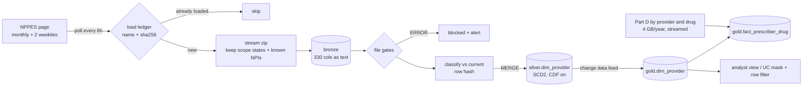

# Design notes

The decisions behind the provider lakehouse, and the places I'd want a reviewer to push.

## Problem and consumer

Anyone who pays or analyzes prescribers (a PBM, a health plan's network team, a pharmacy analytics group) needs to know who a provider was at a point in time. NPPES only publishes who they are now. If a doctor changes specialty or moves practice in March, last year's prescribing should still be read against last year's specialty and address. So the core table is an SCD Type 2 provider dimension built from the NPPES monthly full file plus the weekly change files, and the consumer is a Part D prescriber-by-drug star that joins to the version that was true at the end of each claim year.

## Flow

## What the real files look like

I checked the download page before building anything (Nov 18, 2026).

* The page only ever lists one monthly file and the last two weeklies. Asking for October's monthly or an older weekly returns 404, and the Wayback Machine doesn't have them. Anything I want to replay later has to be kept by me, so the landed subset is the archive.
* Only V2 files are published. CMS stopped V1 in March 2026 after widening the name fields.
* The monthly zip is 1.13 GB and the csv inside is 11.8 GB, covering 2005-05-23 to 2026-11-02. The first weekly covers 11-02 to 11-08, so the monthly and the first weekly overlap by one day. The continuity gate allows that overlap and the row hash makes it harmless.
* A deactivated NPI comes through as a bare row with the NPI and the deactivation date and every other field blank, including state and entity type. 711 of the 31,562 rows in the first weekly look like that.
* Part D files on data.cms.gov are served chunked with no Content-Length. 2024 was 4.06 GB and 28.0M rows, 2023 was 3.88 GB and 26.8M rows.

## Scope: Texas, without losing movers and deactivations

The full registry is about 9.9M NPIs. On an 8 GB laptop I keep Texas and stream everything else past. The filter keeps a row if the practice or mailing state is TX, or if the NPI is already in the dimension. The second rule is what keeps the dimension honest. Without it, a provider who moves to Oklahoma, or one who is deactivated (bare row, no state), would be filtered out and the dimension would keep them as active Texans forever. The cost is that landing depends on the current state of silver, so a full rebuild has to replay files in order. The backfill does.

## Row hash and what counts as a change

The hash covers the 35 fields the dimension keeps (names, both addresses, phone, taxonomies and primary license, dates, organization fields). Last Update Date is left out. NPPES moves that date for edits to fields I don't keep (other identifiers, endpoints) and for re-attestations, so hashing it would open a version for most weekly rows with no visible change. On the real weeklies, 262 of week 1's rows and 284 of week 2's (11.7%) changed nothing but that date and opened no version.

Each staged row is classified against the current version before the merge.

| change_type | when | what the merge does |
|---|---|---|
| new | NPI not in the dimension | insert version 1 |
| unchanged | same hash | nothing |
| changed / deactivated / reactivated | different hash, effective date after the current version's | close current (valid_to = new valid_from), insert version n+1 |
| same_day_fix | different hash, same effective date | update the current version in place |
| stale | effective date before the current version's | nothing, counted |

The effective date is Last Update Date, or the deactivation date for a bare row. `same_day_fix` exists so a correction on the same day doesn't create a zero-length version. `stale` exists so a replayed old file can't roll a provider back.

A bare deactivation row carries forward the provider's attributes from the current version and only changes the deactivation fields. Otherwise the new version would be a provider with no name and no address.

The merge is the standard SCD2 pattern in one MERGE: each changed row appears twice in the source, once keyed by NPI to close the current version, once with a null key so it falls through to the insert branch.

## Rerunning is safe twice over

1. The load ledger (`ops.load_ledger`) is keyed by file name and sha256. A file already loaded with the same checksum is skipped before it's even unzipped. The same name with a different checksum is refused with an alert, since that means CMS republished it or the download is bad, and a person should decide.
2. If the ledger is bypassed, every row hashes the same as the current version, so the merge changes nothing. There's a test that deletes the ledger row and reprocesses a week to prove it.

The ledger is append-only. A rollback is a newer row with status `rolled_back`, so the history of what was loaded when stays readable.

## Backfill

`backfill --since D` restores `silver.dim_provider` with Delta time travel to the version it had before the first file ending after D (the ledger stores that version for every file), then replays every landed file from there in order. `backfill` with no date rebuilds from nothing. Gold is rebuilt in full afterwards, because a RESTORE rewinds silver and the change feed from before it no longer describes the table.

## Parity

The spec I wrote for myself was to rebuild from one monthly plus its weeklies and compare to the next monthly. With real files that isn't possible yet. CMS publishes the December monthly around Dec 7 to 9, and by then November's file is gone from the page. What I can do today, with real files only:

* **Rerun.** Loading week 2 a second time, and the scheduled `run` over the whole page, skipped every file on the ledger. No new Delta commit.
* **Backfill against incremental.** `backfill --since 2026-11-08` restored the dimension to its version before week 2 and replayed it. The result equals the incrementally built table, 655,338 rows each side, 0 rows different.
* **Full rebuild against incremental.** `make rebuild-parity` builds a second lake from nothing out of the same landed files (monthly, both weeklies, both Part D years) and compares. `silver.dim_provider` 655,338 rows and `gold.fact_prescriber_drug` 3,677,110 rows, 0 differences in either, in 331 seconds.
* **Outside check against the live NPPES API.** 300 NPIs (seed 113), half picked from providers the weeklies changed and half from everyone else. The API was called on Nov 18, three days after the last weekly I loaded, so 4 NPIs updated after Nov 15 were skipped. The other 296 matched on name, practice address, city, state, ZIP, primary taxonomy and status. 9 of them were deactivated in the weeklies, and the API confirms it by returning no record (it leaves deactivated NPIs out). My first version of this check counted those 9 as mismatches on every field, which was the check being wrong, not the data.

The monthly check is built into the load. When a monthly arrives on top of weekly-built state, every row with an effective date inside the loaded window should classify as unchanged. Anything else is a miss in the incremental path, recorded as the `monthly_parity_misses` WARN check before the monthly trues the state up. `parity monthly <zip>` runs the same comparison as a dry run. It's covered by tests on hand-written rows, and it'll get its first real run when the December file is out.

## Data quality

Row rules send rows to `silver.provider_quarantine` with a reason and the row as JSON. File gates decide whether the file merges at all.

| Check | Severity | Why |
|---|---|---|
| header matches the 330-column V2 contract | error | the V1 to V2 change renamed and widened fields, a silent shift would land names in the wrong columns |
| rows present | error | |
| NPI unique within the file | error | the merge needs one source row per NPI |
| quarantine rate at most 0.5% | error | a few bad rows are data, a lot of bad rows is a broken file |
| weekly continuity (starts no later than the day after the last loaded end, and moves forward) | error | a skipped week means changes we never see |
| monthly not older than state | error | |
| NPI check digit (Luhn over 80840 + 9 digits) | row rule | |
| entity type 1 or 2 (or a bare deactivation) | row rule | |
| individual without last name, organization without name | row rule | |
| unparseable Last Update Date | row rule | |
| primary taxonomy not in NUCC 26.1 | warn | NUCC adds codes twice a year, a new code shouldn't block a file |
| US practice state not a USPS code | warn | |
| no primary taxonomy flag | warn | |
| volume within 0.5x to 2x of recent files of the same kind | warn | |
| monthly parity misses | warn | see above |

What fired on the real files. The monthly had 4 Texas organizations with no legal business name (quarantined, under the 0.5% gate) and 4 practice states that aren't USPS codes, 3 spelled out as `TEXAS` and 1 as `NA`. Week 1 had one more `NA`. Every row in the Texas subset had exactly one primary taxonomy flag and a valid NPI check digit, and no primary taxonomy fell outside NUCC 26.1. The gates also caught two bugs of mine in tests before they reached real data, see the Spark notes.

## Gold and the as-of join

`gold.fact_prescriber_drug` is one row per prescriber, drug and claim year, partitioned by claim year and reloaded a year at a time with `replaceWhere`. Each row points at the provider version valid on Dec 31 of the claim year.

The dimension only knows a provider from their Last Update Date onward, because the first monthly gives me their current state and nothing older. A provider last updated in 2025 has no version covering 2024. Those facts fall back to the earliest version and say so in `provider_match` (`as_of_year_end`, `earliest_known`, `not_in_registry_scope`). I'd rather report how much of the join is truly as-of than pretend the dimension goes back further than it does. The share of `as_of_year_end` will grow as weekly history builds up.

Real numbers, Texas prescribers in Part D.

| Claim year | Rows | Prescribers | Drug cost | Prescribers matched as of Dec 31 | Earliest known version | Not in the Texas registry subset |
|---|---|---|---|---|---|---|
| 2023 | 1,792,881 | 72,735 | $14.87B | 49,064 (67.5%) | 21,322 | 2,349 |
| 2024 | 1,884,229 | 75,623 | $15.75B | 57,113 (75.5%) | 17,104 | 1,406 |

The last column is prescribers Part D lists in Texas who aren't in my subset of NPPES today. Most will have moved out of state or been deactivated before November 2026. The scope filter only follows NPIs from the day they enter the dimension, so these can't be recovered without older registry files.

`gold.dim_provider` follows silver through the Delta Change Data Feed. Each refresh reads changes since the last processed version (kept in `ops.watermarks`) and merges the latest post-image per surrogate key. A full refresh uses insert overwrite rather than replacing the table, so Unity Catalog masks and row filters stay attached.

## Governance

Analysts see only the states they're granted, and for individual providers the street address, phone and full ZIP are masked. Organizations are not masked. On Databricks that's a Unity Catalog column mask per column and a row filter on `practice_state` (`databricks/sql/10_governance.sql`). Unity Catalog OSS doesn't implement masks or row filters, so locally the same rules are a view in the `analyst` schema with two small tables standing in for account groups, and tests run the view as the current user with and without grants. NPPES is public data, so this is about having the pattern in place for the member-level data that would sit next to it.

## Spark notes

* The first real monthly load wrote an empty change log when it should have had 651,371 `new` rows. The classified rows were cached, but with a 2 GB driver some blocks were evicted, and Spark recomputed them after the MERGE. The recompute read the dimension again, found the rows already there and called them all unchanged. The fix is reading the dimension at the Delta version pinned before the merge, so a recompute gives the same answer. Cache is not a snapshot.
* Two deactivation bugs showed up in tests. `deactivation_date is null or reactivation_date >= deactivation_date` is `false or null` for a deactivated row with no reactivation, which is null, so the row fell through to `changed`. And the carry-forward loop overwrote `entity_type` first while the "bare row" flag was computed from `entity_type`, so the flag went false for every later column and the new version lost the provider's name. Both are fixed and covered.
* Delta reads its log with 50 partitions by default. On a laptop that dominates small commits, so it's 4 here (1 in tests), and shuffle partitions are 8. With the Hive metastore, Delta also tries to sync the schema to Hive on each write, and Hive rejects it with a long stack trace because it only holds a placeholder schema. Turning off Hive's incompatible column type check stops the noise. Together these took a single end-to-end test from minutes to about 35 seconds.
* Wall times on the real run (Apple M2, 8 GB, shared with other jobs). Streaming the 11.8 GB monthly csv to the Texas subset took 182s. Loading that subset into bronze and silver took 136s. Each weekly took 48 to 63s including JVM start. Streaming each Part D year took 74 to 78s, loading both years 70s, gold 55s, the backfill 101s.

## Failure modes

| What breaks | What happens |
|---|---|
| A weekly is never loaded (job down for 2 weeks, CMS rotated it off the page) | the next weekly is blocked by the continuity gate and alerts. Recovery is loading the next monthly, which trues up the state and reports parity misses. |
| CMS republishes a file under the same name | ledger refuses it (checksum differs), alert, a person decides |
| Header changes (another V3) | header gate blocks, alert, nothing merged |
| Job dies mid-merge | Delta MERGE is one commit, so the dimension is either before or after. The ledger row is only written after the merge, so the next poll loads the file again, and the hashes make that safe. |
| Bad merge discovered later | `backfill --since` restores and replays |
| NPPES page layout changes | file discovery finds nothing, the freshness check alerts after 24 hours |

## SLA, monitoring, cost

* SLA is a weekly file loaded within 24 hours of CMS posting it. The job polls every 6 hours. `freshness` compares the page's Last-Modified time with the ledger and alerts if a published weekly is still not loaded after 24 hours.
* Every command writes a row to `ops.pipeline_runs`, every check to `ops.dq_results`. Alerts go to the log and a webhook, and on Databricks the job emails on failure.
* Cost. I haven't run it on Databricks yet, so I don't have measured cluster minutes. Locally a weekly is under about a minute of a 4-core laptop. The lake is 858 MB on disk after the real run, but most of that is old file versions. `silver.dim_provider` alone is 417 MB because every MERGE rewrites the files it touches, and nothing is vacuumed. That's deliberate for now, since backfill depends on time travel. The rule I'd set is a VACUUM retention longer than the longest backfill window I'd ever replay, for example 30 days, which keeps about four weeklies of history restorable. On Free Edition the weekly job should fit easily inside the daily serverless quota, but I'd want to measure that before writing a number down.

## What I'd do next

* Run the monthly parity for real when the December 2026 file is posted, and keep the result in the README.
* Seed history further back. The first monthly only gives current state. Old monthly files aren't public anymore, so the realistic way is to keep loading and let history accumulate.
* Load the practice location and other name reference files that ship in the same zip, so multi-location providers are modeled properly.
* Add openFDA NDC data to give the drug dimension real product codes instead of brand and generic names.
* Run the bundle on a real workspace. I've written it against the docs but haven't deployed it, see the README.
* Schedule OPTIMIZE and VACUUM on silver with a retention tied to the backfill window.
