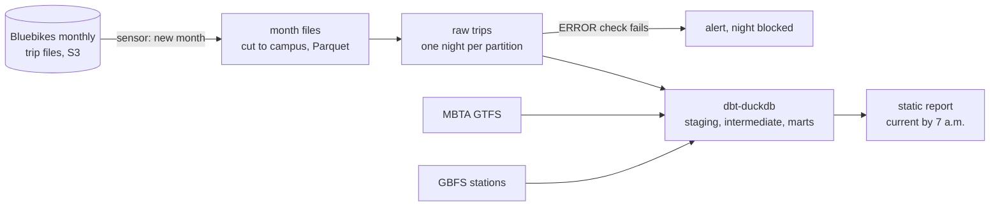
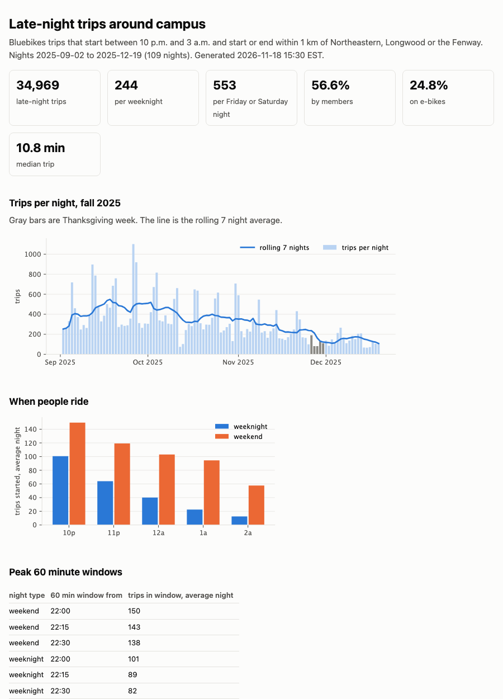

# 114 Late-night campus mobility

Nightly pipeline on public Bluebikes trip data. It keeps trips that start between 10 p.m. and 3 a.m. and start or end within 1 km of Northeastern, Longwood or the Fenway, and answers the questions a campus night shuttle team asks. How many people move around late, at what hour, from which corners, when the peak is, how demand moves over the semester, and whether the night bus covers it.

I did a ridership analysis like this on a university night shuttle in grad school. That data isn't public, so this is the same set of questions rebuilt as a production pipeline on public bike share trips around the same campus, with MBTA GTFS for the transit side.

Dagster runs it one night per partition, DuckDB is the warehouse, dbt builds the models and the output is a static HTML report.





## Data

* [Bluebikes system data](https://bluebikes.com/system-data), monthly trip files in the public `hubway-data` S3 bucket, under the [Bluebikes Data License Agreement](https://bluebikes.com/data-license-agreement). The pipeline downloads them; the repo doesn't redistribute them. Not affiliated with Bluebikes, Lyft or the cities.
* Bluebikes [GBFS](https://gbfs.bluebikes.com/gbfs/gbfs.json) station information for dock counts.
* [MBTA GTFS](https://www.mbta.com/developers/gtfs) static feed for scheduled night bus speeds and stops with service after 10 p.m.

## What it does

1. **Month files.** Downloads the months a run needs, keeps trips that touch the campus area (about a quarter of all rows) and writes Parquet. An ETag ledger skips months that haven't changed.
2. **Raw load per night.** ERROR checks first (month files present, trips present, under 2% bad rows). Then one night is deleted and inserted in one transaction, with bad rows sent to a quarantine table with a reason. WARN checks after (volume against comparable nights, repeated ride ids, trips with no end station).
3. **dbt.** Staging fixes types and the daylight saving fall-back hour, intermediate assigns each end of a trip to a campus cluster, marts cover hourly and nightly demand with rolling windows, duration buckets, station hotspots with net flow, peak 60 minute windows, transit coverage and bike vs bus speed. The fact and the hourly mart are incremental, delete and insert by night.
4. **Report.** One static HTML page, rebuilt every morning, freshness deadline 7 a.m.
5. **Sensor.** Lists the bucket every six hours and starts a run for a new month.

Decisions, the checks table, failure modes, SLA and cost are in [docs/design.md](docs/design.md).

## Results

Fall 2025, September 2 to December 19 (109 nights), one `make backfill` on my laptop (Apple M2, 8 GB) from an empty data folder.

| | |
|---|---|
| Month files read | 4, 1,633,167 trips, 396,037 touching campus |
| Late-night trips loaded | 34,969 |
| Average night, outside Thanksgiving week | 244 weeknight, 553 Friday or Saturday |
| Members / e-bikes / median trip | 56.6% / 24.8% / 10.8 min |
| Quarantined | 29 trips, all longer than 24 hours |
| Nights clean / with warnings / blocked | 106 / 3 / 0 |
| Backfill time | 194 s end to end, of which 18 s download and Parquet, 8 s load, 75 s dbt build with tests |
| Rerun of the same backfill | 139 s, raw step 2.4 s, no rows changed |

What the data says.

* The first hour is the busiest. On weeknights trips fall from about 103 between 10 and 11 p.m. to 23 between 1 and 2 a.m. Weekend nights hold up much longer, about 100 trips between 1 and 2 a.m.
* Fenway leads. The top station is Beacon St at Massachusetts Ave, about 3 trips per dock per weekend night, and the busiest Fenway stations lose 4 to 6 bikes a night, which is the restocking list for the morning.
* 38.5% of trips leave the area, 32.1% arrive from outside and 29.4% stay inside it.
* The busiest campus stations aren't transit deserts. All of the top ten have a stop with night service within about 110 m. That was a weaker gap than I expected.
* On short trips inside the area a classic bike and the scheduled night bus are about the same straight-line speed (around 9 km/h), and an e-bike is about 12 to 13 km/h. The bus number doesn't include waiting for it.
* The volume check fired on three real nights. October 12 and 13 were the nights of the nor'easter (74 and 103 trips against about 330). November 15 had 160 against 590; trips fell off from about 9 p.m., and rain was in the forecast, but I haven't checked it against an observed weather record.

Things I hit on the way, written up in the design notes.

* My first backfill stopped on November 1. Nineteen trips "ended before they started" because the files use local time and 1 to 2 a.m. happened twice that night. They're real trips, so staging now adds the hour back and flags them (18 trips).
* Month files are filed by trip end time, so the last night of a month waits for the next file. Running October 29 to 31, 2026 today loads the 29th and 30th and blocks the 31st with `missing month files ['202611']`.
* File names drift (`.zip`, `.csv.zip`, a bare `.csv`), and the zips carry a `__MACOSX` file.
* The first week of the current MBTA feed had the Green Line E branch replaced by buses, which made the Northeastern stop look like it had no night service. The GTFS step now picks the week with the most rail service.

## Run it

Needs Python 3.11. No Docker, the warehouse is one DuckDB file.

```bash
make setup            # venv, dbt manifest
make backfill         # fall 2025, downloads 4 month files (about 70 MB, deleted after conversion)
make run NIGHT=2025-10-17
make backfill FIRST=2026-09-08 LAST=2026-10-30
make test             # 17 tests, about 2 minutes (the dbt parity test is most of it)
make dev              # Dagster UI on http://localhost:3114
make gtfs             # refresh the MBTA seeds from the current feed
```

Rerunning any night or range is safe. Unchanged nights are skipped, changed ones are replaced, and every check result is kept in `ops.check_results`. The page lands in `site/index.html`, and CI builds a two-week version of it as a workflow artifact that GitHub Pages can serve.

## Layout

```
src/latenight/
  bluebikes.py     bucket listing, month download, cut to campus, ETag ledger
  load.py          one night into raw, quarantine, load ledger
  checks.py        ERROR and WARN checks
  stations.py      GBFS station snapshot
  gtfs.py          MBTA night speeds and night stops (dbt seeds)
  calendar.py      academic calendar labels (dbt seed)
  definitions.py   Dagster assets, partitions, sensor, schedule, alerts
  report.py        static HTML report
dbt/
  models/staging, intermediate, marts
  tests/           singular tests (raw equals fact, hourly equals fact, night window)
  seeds/           calendar, campus anchors, GTFS-derived CSVs
tests/             unit tests and the incremental vs full refresh parity test
docs/design.md
```

## Limits

Bikes are one slice of late-night travel, so this shows where and when people ride, not total demand. The campus area is a 1 km radius around three points, not real campus boundaries. Dock counts are today's GBFS snapshot, so trips per dock is a stand-in for dock availability history, which isn't public. The transit side is the published schedule, not real-time. The academic calendar uses typical Boston dates as labels and isn't any one school's official calendar.
