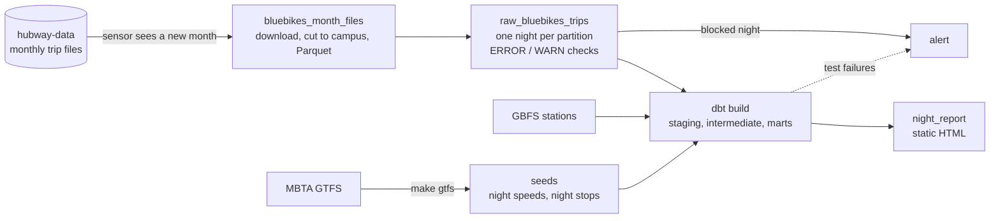

# Design notes

The decisions behind the pipeline, what breaks and how it shows up, and what I'd change.

## The question

A campus night shuttle team (or a bike share planner) wants to know how many people move around campus late at night, when, from where, and whether transit covers it. I answered that question once in grad school on a university night shuttle's ride logs, which aren't public. This is the same set of questions on public data. Bluebikes trips that start between 10 p.m. and 3 a.m. and start or end within 1 km of Northeastern, Longwood or the Fenway, with MBTA GTFS for the transit side.

The consumer is a static report that has to be current every morning, and the marts behind it.

## Flow

## Partitions are nights, the source is months

Bluebikes publishes one file per month, a few days into the next month. I still partition by night, keyed by the evening's date, because that is the grain every question is asked at, and because a rerun or a fix should touch one night and nothing else.

The month files are handled one step earlier. `bluebikes_month_files` downloads the months a run needs, cuts each one down to trips that touch the campus area (about a quarter of all rows) and writes Parquet. The raw download is deleted after that. A ledger keyed on the S3 ETag makes the step a no-op until Bluebikes replaces a file.

A sensor lists the bucket every six hours and asks for a run over a month's nights when a new file shows up. Every partitioned asset has a single-run backfill policy, so a month or a whole semester is one Dagster run and one dbt invocation instead of a hundred.

## Things the source does that the code has to handle

* **File names drift.** Most months are `YYYYMM-bluebikes-tripdata.zip`, but 202511 is `.csv.zip` and 202609 is a bare 133 MB `.csv`. Months are matched on the prefix and the format on the suffix.
* **The zips carry a `__MACOSX/._` file** next to the CSV. The extractor takes the one real CSV and fails if there isn't exactly one.
* **Months are filed by end time.** The October 2025 file has 57 trips that started on September 30, and no trip appears in two files (I checked September against October by ride_id). So the last night of a month needs the next month's file, and the loader's ERROR check holds that night back until it lands. The sensor runs a new month up to its second-to-last night for the same reason.
* **The system data page describes an older schema** (trip duration, bike id, user type). The files since 2023 use ride_id, rideable_type, started_at, ended_at, station ids and coordinates, member_casual. I built against the files.
* **Station ids get renamed.** C32063 shows up as both "Mass Ave T Station" and "Mass Ave T Stop" in fall 2025. Stations are keyed on id and take the latest name. A WARN test fires if more than 10 stations change names at once, which would look more like ids being reassigned.
* **E-bikes report GPS, not a dock.** Classic bike trips carry the dock's coordinates, e-bike trips carry wherever the bike was, and an e-bike can end away from any dock with no end station. Area is decided from each trip's own coordinates; station locations are the median of classic bike trip ends.

## Daylight saving time broke the first backfill

The files use local time with no offset. On November 2, 2025 clocks fell back and 1 to 2 a.m. happened twice. My first full backfill stopped on the night of November 1 because 19 of 591 trips "ended before they started", which is over the 2% quarantine limit, an ERROR check. Every one of them started in the first 1 a.m. and ended in the second one (for example started 01:58:52, ended 01:06:08). Those are real trips.

The fix has two parts. The loader doesn't quarantine a negative trip when both ends are in the repeated hour on the first Sunday of November. Staging adds the hour back to the end time and flags the row (`ended_at_shifted_for_dst`, 18 trips in fall 2025). Trips that start and end inside the repeated hour without going negative can't be told apart, so they just carry `in_repeated_hour` (177 trips that night). There's a unit test with the exact trip above, and the dbt test suite checks that its duration comes out at about 7 minutes.

The other lesson from that run is a tradeoff of single-run backfills. One blocked night blocks the dbt step for the whole range, because the blocking check belongs to the asset, not to a night. The good nights were already in raw and the rerun only had to load November 1, so it cost a rerun, not data. For a long backfill I'd still rather know.

## Rerunning is safe

* `raw_bluebikes_trips` deletes and inserts one night in one transaction. A reader sees the old night or the new night.
* The load ledger stores the ETags of the source files a night was built from. Same files means the night is skipped, a replaced file means the night is reloaded.
* `fct_late_night_trips` and `mart_hourly_demand` are dbt incremental models with `delete+insert` on night, limited to the run's nights by vars Dagster passes in. The other marts are small tables rebuilt from the fact.
* `tests/test_dbt.py` builds three nights (a month boundary and the DST night) one at a time, reruns the first one, then compares the fact and hourly tables row for row with a full refresh. They have to be identical.

## Data quality checks

ERROR checks run before anything is written and block the night and dbt. WARN checks let the night through, get written to `ops.check_results` and go to the alert webhook.

| Check | Severity | Why |
|---|---|---|
| every month file the night needs is present | error | a month-end night without the next file would be silently short |
| at least one valid trip | error | zero late-night trips around three campuses means a broken file, not a quiet night |
| quarantined rows at most 2% | error | a few bad rows a night is normal, more is a format change |
| trips within 0.4x to 2.0x of the same weekday in the same period, last 4 weeks | warn | catches partial files and real events |
| a ride_id in two month files | warn | never happened, but the dedupe depends on it |
| trips without an end station at most 5% | warn | lost or stranded e-bikes |
| dbt tests (unique ride_id, accepted values, raw equals fact, hourly equals fact, trips start inside their night, no negative durations) | error | the marts have to add up |

Rows that fail a rule go to `raw.bluebikes_trips_quarantine` with a reason. In fall 2025 that was 29 trips, all longer than 24 hours.

The volume check compares like with like. In 112 a trailing average flagged the start of a break and then got used to it within a week. Here the baseline is the same weekday over the last four weeks, but only nights in the same kind of period (classes, finals, break), and the check says "no comparable nights" instead of guessing. In fall 2025 it fired three times. October 12 and 13 had 74 and 103 trips against about 330, the nights of the October 12 to 14 nor'easter. November 15 had 160 against 590; trips fell off from about 9 p.m. on, and the forecast that day called for rain overnight, but I haven't matched it to an observed weather record. I left the band wide because late-night bike demand swings a lot with weather and events.

## MBTA GTFS

Two seeds come from the static feed and are committed with the feed version, so the warehouse doesn't shift every time the MBTA publishes.

* **Night bus speed** by hour and night type, from scheduled stop-to-stop times on bus segments inside a box around campus, plus a detour factor (route length over straight-line distance, median 1.45). The report divides bus speed by the detour factor so it compares with bikes' straight-line speed.
* **Night stops**, every bus, subway and light rail stop near campus with its departures between 10 p.m. and 3 a.m.

GTFS times run past 24:00 for trips after midnight, so a 25:10 departure on a Friday service day is 1:10 a.m. on Friday night. The night is the departure time minus four hours, the same rule the trips use.

The reference week matters. My first version took the first full week of the Fall 2026 feed, and the Northeastern Green Line stop had no departures at all. That week the E branch was replaced by shuttle buses (service ids starting `DIV`). The code now picks the full week with the most subway and light rail trips, which was November 16 to 22.

GTFS-realtime (TripUpdates and VehiclePositions on cdn.mbta.com, no key needed) would show actual night travel times instead of scheduled ones. I left it out for now. Polling it only means something at night and over many nights, and the scheduled feed already answers the comparison the report makes.

## SLA and monitoring

* The page is rebuilt every morning at 6:30 and must be current by 7 a.m. That's a Dagster `FreshnessPolicy` (cron deadline 7 a.m., 24 hour window) on `night_report`.
* For data, the target is a new month's nights loaded within a day of the file appearing in the bucket. The sensor checks every six hours.
* Alerts go to a Slack-style webhook for any failed run, any blocked night and any WARN check. Without a webhook they go to the log.
* Run history is Dagster's run storage plus `ops.load_ledger` (one row per night, current state) and `ops.check_results` (every check on every attempt, so a rerun doesn't hide the failure before it).

## Cost

Near zero. A month file is 6 to 31 MB zipped (one month was a 133 MB plain CSV) and S3 egress from a public bucket costs me nothing. A full semester backfill took 194 seconds on my laptop from an empty data folder, the DuckDB file is about 11 MB, and GitHub Actions runs the tests and a two-week end-to-end build on every push to this folder. MotherDuck's free tier would host the warehouse if the report needed to query it live, but a static page doesn't.

## Failure modes

| What breaks | What you see | What to do |
|---|---|---|
| Bluebikes renames a month file in a new way | the sensor doesn't see the month | widen `MONTH_FILE`, there's a test with every name seen so far |
| a month file is replaced with corrections | new ETag, the month and its nights reload | nothing, that's the point of the ledger |
| columns change | Parquet conversion still works (all text), the loader quarantines rows that don't parse and the 2% ERROR check blocks | update the loader's column list |
| the next month is late | the last night of the month stays blocked | nothing, it loads when the file lands |
| GBFS drops a station | capacity is null, trips per dock is null for it | nothing |
| MBTA stop ids change | `make gtfs` diff shows it | review the seed diff before committing |

## What I'd do next

* Poll GBFS station status every few minutes overnight for real dock availability. Trips per dock is a stand-in.
* Join hourly weather (NOAA for Logan) so the volume check can tell a storm from a broken file.
* Sample GTFS-realtime at night for a month and compare actual bus times with the schedule.
* Split the ERROR check from the single-run backfill, so a blocked night skips itself instead of holding up dbt for the whole range.
* Extend the window to 9 p.m. The peak in my window is always the first 60 minutes, which says the evening peak starts earlier.
