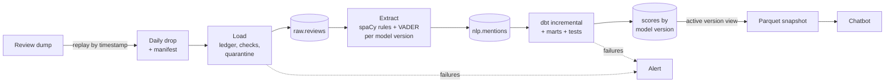

# 115 Review-scored product finder

Daily pipeline that turns beauty product reviews into per-concern product scores, for a menu driven assistant. You pick skin or hair, a concern (dryness, frizz, breakouts, irritation and so on), then your type (curly, sensitive skin), and it shows the products reviewers like you were happiest with, with the review sentences behind each score. There's no free text box. Every answer maps to a tested score.

Data is the real [Amazon Reviews 2023](https://amazon-reviews-2023.github.io/) All_Beauty category, 701,528 reviews. It runs locally on DuckDB with dbt, Airflow and Streamlit. The dbt SQL and a Terraform module are kept ready for Snowflake, but I haven't run them there (no account).



## What it does

1. **Replay.** The dump is static, so everything before 2023 becomes one history drop and each 2023 day becomes its own drop, split by the review's own timestamp. Each drop has a manifest written last.
2. **Load.** Checks the manifest, derives a review id (the source has none), quarantines exact repeats and empty reviews with a reason, runs the data checks and replaces that day in one transaction. ERROR checks block the day, WARN checks load and alert.
3. **Extract.** spaCy entity rules tag concerns and skin or hair types, and VADER scores the sentence around each concern. Output is keyed by review id and model version.
4. **Model.** dbt incremental models keyed on (review_id, model_version), then scores per product, concern and type, with a minimum of 5 reviews and evidence sentences. Tests block the publish if anything is off.
5. **Serve.** A view points at the active model version. The chatbot reads a Parquet snapshot of it, so it never touches the database while a run is writing.

A new model version is backfilled next to the old one and switched on with a one row update, so nothing is overwritten and rollback is the same command.

Decisions, the check list, failure modes, SLA and cost are in [docs/design.md](docs/design.md).

## Results

Full run on my laptop (M2, 8 GB), shared with two other builds.

| | |
|---|---|
| Reviews loaded / quarantined | 693,547 / 7,981 (7,261 exact repeats, 720 empty) |
| Drops | 1 history (687,123 reviews) + 250 daily (14,405), 2023-01-01 to 2023-09-09 |
| History load and scoring | 885s for 687k reviews. Extractor peaked near 110 MB on a 20k review sample |
| Daily run, first 14 days of 2023 | load + score 0.8s avg, dbt build + publish 22.5s avg (44.9s worst) |
| dbt tests per build | 38, all passing on the final build |
| Python tests | 27 (unit, a dbt build on fixture rows, chatbot click-through) |
| Published scores (rules-v1) | 2,463 rows over 1,429 products |
| Forced rerun of one day, twice | identical counts and content hashes in every layer |

Then I switched the model. rules-v2 was scored for every review next to v1 (6 min 39 s), both built and tested, then activated with one row update (8 s). v2 publishes 2,149 score rows over 1,219 products, stricter than v1 mainly because bare "dry" no longer matches verbs. 40 of the 65 slots in the "any type" top 5 lists kept the same product. v1's scores are still there for rollback.

A parity run built January twice, a dbt build after each day versus one build at the end, and the incremental models and marts came out identical.

Extraction quality on a manually reviewed label set of 148 reviews, split 49 dev (used to write rules-v2) and 99 test (only scored). The test split has 28 concern labels, so read these as rough.

| Test split | rules-v1 | rules-v2 |
|---|---|---|
| Concern precision / recall | 0.64 / 0.57 | 0.67 / 0.57 |
| Type precision / recall | 0.90 / 0.69 | 0.91 / 0.81 |
| Outcome direction right | 6 of 16 | 10 of 16 |

v2 fixed what it was written to fix on dev (concern F1 0.55 to 0.87 there) and helped types and polarity on test, but concern recall on test didn't move. The misses are phrasings with no vocabulary ("my hair fell out horribly", "gunk out of my pores"). That's the honest state of a rules model with sentence level VADER.

Two data checks were too strict for real data, and the run history shows it. A 1% quarantine warning fired on 8 of the first 14 days because two repeated reviews in a 130 review day is 1.5%. Later a 5% blocking rule stopped 31 days in the thin 2023 tail, where one repeat in a 15 review day is enough. Repeats lose nothing, so they no longer count toward blocking, and both rules need at least 10 rows. Rerunning the range reloaded exactly those 31 days and skipped the 202 already loaded.

## Run it

Needs Python 3.11. Docker only for `make tf-validate`.

```bash
make setup            # venv with dbt-duckdb, spaCy, VADER, Streamlit
make data             # downloads ~134 MB once, writes the drops
make init             # warehouse, product catalog, seeds, rules-v1 active
make backfill         # history + every 2023 day, a dbt build after each
make run DATE=2023-01-10 FORCE=1
make score-v2         # versioned backfill, current view doesn't move
make activate VERSION=rules-v2
make eval             # precision / recall on the test split
make chat             # http://localhost:8215
make test lint        # pytest (includes a dbt build on fixture rows) and ruff
```

Airflow runs from its own venv. `make airflow-setup`, then `make airflow` for the UI on port 8115, or `airflow dags test product_finder_daily 2023-01-15`.

## Layout

```
src/finder/
  replay.py      split the dump into a history drop and daily drops
  ingest.py      manifest check, review id, quarantine, load one day
  checks.py      data quality rules
  taxonomy.py    concern and type vocabulary, v1 and v2 additions
  extract.py     spaCy entity rules + VADER, model versions
  enrich.py      score a day, or every review missing a version
  runner.py      run / backfill / score-version / activate / freshness
  parity.py      per-day builds vs one build at the end
  label.py       evaluation sample, labeling prompt, precision / recall
dbt/             staging, incremental intermediate models, marts, seeds, tests
dags/            Airflow DAG
app/chatbot.py   Streamlit menu and button assistant
eval/            148 sampled reviews, labels, results per version
infra/terraform/ Snowflake database, XS warehouse, resource monitor, roles
docs/design.md
```

## Limits

The scores reflect what reviewers wrote, through a rules model that misses a lot of phrasing and a sentence level sentiment model that doesn't know beauty vocabulary. Good enough to rank products for a concern when there are many reviews. Not good enough to say anything about a product with five. Product domain comes from title keywords, so hair tools sit with hair products and pick up odd scores (a curling wand tops the irritation list because reviewers write about burns). Nothing here has run on Snowflake.
