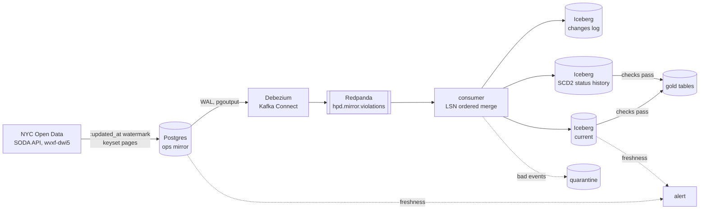

# 116 Housing violation CDC into Iceberg

Change data capture for NYC housing code violations, for a housing team that wants to know how long violations take to close and which buildings keep getting class C (immediately hazardous) violations, with every status change kept instead of only the latest snapshot.

The open data API only serves the current version of each violation. This pipeline polls it into a Postgres "ops mirror", lets Debezium turn every row change into an event on Redpanda, and merges those events into Apache Iceberg tables keyed by violation id and ordered by Postgres log position (LSN), so a replay never applies anything twice.



## Data

[HPD Housing Maintenance Code Violations](https://data.cityofnewyork.us/Housing-Development/Housing-Maintenance-Code-Violations/wvxf-dwi5) from NYC Open Data, pulled through the SODA API with no app token, 5,000 rows a page and a 1 second pause. I kept it to the Bronx, violations inspected from 2026-04-01, which is 214,235 rows. Raw data is never committed. It lives in Postgres and Redpanda volumes and under `data/` (gitignored), and `make clean` plus `make down` removes it.

## What it does

1. **Poll.** Keyset pages on `(:updated_at, violationid)` after the stored watermark, with a 60 minute overlap. Rows are typed and checked, bad ones go to `mirror.quarantine` with a reason, and the upsert only writes rows whose content changed. Each page commits with its watermark.
2. **Capture.** Debezium's Postgres connector on `pgoutput` streams the mirror's WAL to Redpanda as JSON.
3. **Merge.** Per violation, events at or before the applied LSN are dropped, and so are events that don't change the row hash. Kept events go to a changes log, an SCD2 status history and a current table, in that order, then offsets are committed.
4. **Publish.** Blocking checks on the current and history tables, then the two gold tables. A failed check keeps the last good gold.
5. **Backfill.** A Debezium incremental snapshot for an inspection date range, then a parity check of the snapshot alone against the incremental tables and the mirror.

Decisions, checks, failure modes and SLA notes are in [docs/design.md](docs/design.md).

## Results

One run on my laptop (Apple M2, 8 GB) on Nov 20 to 21, 2026, shared with two other builds. Connect on the host JVM, Postgres and Redpanda in Docker.

| | |
|---|---|
| Rows (Bronx, inspected from 2026-04-01) | 214,235 in the mirror, in Iceberg current and in the change log, 0 quarantined |
| Seed, rows last changed before Nov 14 | 171,002 rows, 38 pages, 428 s |
| First poll from the Nov 14 watermark | 43,233 rows from the six daily refreshes after it, 9 pages, 92 s |
| Same poll again | 30,930 rows re-read through the overlap window, 0 written, 0 change events |
| Consumer, seed and poll | 22 batches, 2 to 50 s each. Mirror commit to Iceberg commit was 85 s in the worst batch (bulk load) and 41 s worst during the poll |
| Status history | 329,980 rows, 115,745 of them derived Open stretches from first images |
| Replay of the whole topic into live | 214,247 messages, 0 kept, Iceberg snapshot ids unchanged |
| Rebuild from offset 0 into a scratch lake | current, change log and history identical to live, 300 s |
| Backfill, incremental snapshot of June | 28,250 snapshot events. Live dropped all of them as unchanged. Snapshot-only lake vs live vs mirror, all equal, and the time to close table for June matched (52 rows) |
| Drift drill, `rentimpairing` for October | 29,931 real updates through Debezium, Iceberg schema id 0 to 1, 27,438 N and 2,493 Y, the rest null. Worst lag 21 s |
| Freshness after all of it | connector running, 0 mirror rows missing from Iceberg |
| Tests | 37 (35 without the stack, 2 on the running stack in their own database and topic), ruff clean |
| Disk | Iceberg live 56 MB, Docker volumes 400 MB, Kafka and the Debezium plugin 126 MB |

Gold, time to close by class across the Bronx (violations issued at least 90 days before the latest inspection date for the 90 day share).

| Class | Violations | Closed | Median days to close | p90 | Closed within 90 days |
|---|---|---|---|---|---|
| A | 49,386 | 15,623 | 82 | 149 | 24.2% |
| B | 96,929 | 30,881 | 83 | 121 | 27.6% |
| C | 61,331 | 23,220 | 56 | 105 | 43.3% |
| I | 6,589 | 119 | 57 | 154.6 | 13.0% |

Most violations in this window are still open, so the medians only describe the ones that closed. The 90 day share uses a fixed cohort, which is the fairer number. 2,975 buildings had class C violations on 3 or more inspection days. The top one, 2265 Olinville Avenue, had 233 class C violations over 54 inspection days, 184 still open.

SLA. The pipeline part (mirror commit to Iceberg) stayed under a minute and a half. With a poll every 5 minutes and a poll taking 1 to 2 minutes, a change Socrata publishes reaches Iceberg in well under the 15 minute target. HPD itself publishes once a day, and no new refresh came out while I was running this, so I couldn't time a fresh one end to end.

## Things that went wrong

* **The Docker disk filled up.** The first seed crashed Postgres with `could not write to file "pg_wal/xlogtemp": No space left on device`. Redpanda had preallocated segment files, and the 25 partition Connect offsets topic alone took most of a 985 MB volume. Connect's topics are now one partition each and `make stack-up` shrinks Redpanda's segment size. The same disk is why Connect runs on the host JVM.
* **Incremental snapshot events have no LSN.** The first backfill sent 28,250 events to quarantine with `no lsn`, because Debezium leaves `source.lsn` null on incremental snapshot reads. The quarantine share check alerted and nothing reached the Iceberg tables. Those events now take their order from the stream position in `source.sequence`.
* **A stale Connect worker.** After a restart an old Connect process from an earlier session still held the REST port, kept a stale offset and never wrote a change event, while the connector reported RUNNING. I found it with `lsof`. `make connect-up` now refuses to start when something else holds the port.
* **Subscribing before the topic exists.** The consumer sat idle until its next metadata refresh when it started before Debezium had created the topic. It now waits for the topic first.

## Tradeoffs

* pyiceberg rewrites the files that hold touched ids (copy on write). Fine at 214k rows, not at hundreds of millions, where I'd use Spark or Flink with merge on read.
* History before the first poll is inferred from the source's dates and flagged `derived`. Only changes after the first image are observed.
* Deletes in Socrata aren't detected, the poller only upserts.
* There is no cross-table transaction in Iceberg. The write order and per-table idempotency stand in for it.

## What I'd change

* Run `poll-loop` and `follow` for a few weeks so the history holds real status transitions, then add a time between statuses table.
* Periodic Iceberg maintenance (snapshot expiry, compaction). Every batch adds a snapshot.
* A REST catalog so DuckDB's iceberg extension and other engines can read the tables directly.

## Run it

Needs Python 3.11, Docker and Java 17+ (Connect runs on the host JVM, see design.md).

```bash
make setup                          # venv
make up                             # postgres + redpanda, mirror DDL, Kafka Connect, Debezium connector
make follow &                       # consumer, publishes gold every 5 minutes
make seed UNTIL=2026-11-14T00:00:00 # first load, leaves later changes to the poller
make poll                           # incremental, rerun it and nothing changes
make publish gold                   # checks, gold tables, print them
make replay-check                   # replay the whole topic into live, nothing may change
make rebuild                        # replay into a scratch lake, every table must match
make backfill FROM=2026-06-01 TO=2026-07-01
make backfill-apply SINCE=<since from the backfill output> && make parity FROM=2026-06-01 TO=2026-07-01
make drift-drill FROM=2026-10-01 TO=2026-11-01
make freshness                      # exit 2 and an alert when a change is older than 15 minutes and not in Iceberg
make ci                             # ruff and the tests that need no stack
make test                           # also the stack tests, in their own database, connector and topic
make down
```

## Layout

```
src/violcdc/
  soda.py       SODA client, keyset paging, typing and row checks
  mirror.py     mirror DDL, change-only upsert, watermark, run log, snapshot signal
  connect.py    Kafka Connect REST
  events.py     Debezium event to change row
  merge.py      LSN ordered merge into the three Iceberg tables
  history.py    SCD2 status intervals
  gold.py       checks and gold tables
  parity.py     table and range comparisons
  freshness.py  SLA check
  consumer.py   Kafka loop, batch log
  cli.py
sql/mirror.sql  mirror tables, row hash trigger, signal and heartbeat tables
docker/         compose, Connect worker, connector config
```
