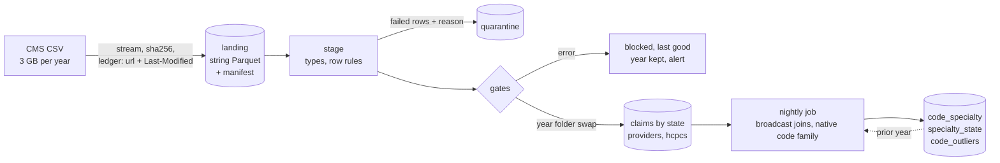

# 118 Medicare Spark tuning

A nightly PySpark job that summarizes Medicare payments by service code and specialty, built as a real batch pipeline and then tuned one fix at a time with measured before and after numbers. The consumer is a payer analytics team that reads three tables per data year and complained the job was slow and uneven.

Data is the real CMS [Medicare Physician & Other Practitioners - by Provider and Service](https://data.cms.gov/provider-summary-by-type-of-service/medicare-physician-other-practitioners/medicare-physician-other-practitioners-by-provider-and-service) file, data years 2023 and 2024, 9.66M and 9.78M lines. Everything runs on local PySpark 3.5.3.



## What it does

1. **Land.** Streams one year's CSV into zstd Parquet with pyarrow, so the 3 GB file never sits on disk. Checks the header, hashes the bytes, writes a manifest last. The ledger key is the URL plus Last-Modified, so an unchanged year costs one HEAD request.
2. **Stage.** Casts types, tags every failing row with reasons, writes the fact partitioned by state, a provider dimension and an HCPCS dimension, then runs the gates. Only if no ERROR gate fails is the year's folder swapped in.
3. **Summarize.** The nightly job. Joins claims to providers and HCPCS, adds the code family, and writes three marts per year. `code_specialty` carries the prior year's payment, so republishing a year makes the next one stale and `make run` rebuilds it.
4. **Experiments.** Five scripts plus the whole job, each with the slow version and the fix, timed round robin, with stage times, shuffle bytes, spill and task skew read back from Spark's event log.

Every step takes a year, replaces that year in one rename and is skipped when its inputs haven't changed. Decisions, gates, every fix explained in plain words, failure modes and SLA are in [docs/design.md](docs/design.md).

## Results

Machine: Apple M2, 8 cores, 8 GB, Java 21. Spark in local mode, `local[3]` with a 2 GB driver. The Mac was shared with two other builds the whole time (load average 5 to 9), which is why some single runs took 2 to 8 times longer than their neighbours. I report the median of 3 timed runs after a warm-up, with variants interleaved so a slow minute hits all of them. Local mode has no network shuffle and one JVM, so a cluster would give different seconds. Read the ordering, not the absolute times.

### Pipeline, real run

| | 2023 | 2024 |
|---|---|---|
| CSV streamed, landed as Parquet | 3.06 GB in 53.9 s | 3.25 GB in 70.2 s |
| Lines staged / quarantined | 9,660,647 / 0 | 9,781,673 / 0 |
| Providers | 1,175,281 | 1,207,473 |
| Medicare payment | $93.72B | $97.29B (+3.8%) |
| Stage (types, rules, 66 fact files, gates) | 154 s | 150 s |
| Nightly job, tuned | 83 s | 116 s |
| Mart rows (code_specialty, specialty_state, code_outliers) | 48,165 / 4,796 / 35,321 | 48,512 / 4,927 / 36,444 |
| Rerun of both years | all 6 steps skipped by the ledger, nothing written |
| Backfill 2023 to 2024 into a second data home vs incremental | 13 of 14 tables identical. 2024 code_outliers 36,444 vs 36,451 lines (percentile_approx, see below) |
| Tests | 48 pytest (47 pass, the pandas UDF check skips on Java 21), ruff clean |

### Tuning, data year 2024

| Experiment | Before | After | What changed |
|---|---|---|---|
| Whole nightly job | 74.9 s, 1,281 MB shuffled | 49.8 s, 650 MB | all the fixes below (34% faster) |
| 1. Skew in the outlier join | slowest join task 865 ms vs median 108, hot partition 16.6x median | salted 156 vs 26 ms. Broadcast removes the fact shuffle (203 to 49 MB) | run time flat at 32 to 34 s, see below |
| 2. Provider join | forced sort merge join 4.5 s, 139 MB shuffled | broadcast 2.0 s, 0.1 MB | Spark broadcast on its own, estimate 7.6 MB < 10 MB |
| 3. Small files on write | 11,688 files of 54 KB, 126 s write, 14.7 s read | 66 files of 7.4 MB, 52.5 s write, 1.5 s read | repartition("state") + maxRecordsPerFile |
| 4. Code family | Python UDF 4.3 s | native functions 3.6 s | pandas UDF can't run on Java 21 here |
| 5. Caching the enriched fact | no cache 23.9 s | MEMORY_AND_DISK 32.2 s | caching was slower, not used as a win |

Full tables per experiment come from `make results` (JSON in `results/`).

What I'd point out from these

* **Skew.** 99214 alone is 5.35% of all lines. In the sort merge join its partition read 536,058 rows against a median of 32,369. Salting cut the hot partition 3x. AQE's skew join never split it, with defaults a partition must be over 256 MB, and with the threshold at 8 MB its coalescing raised the median until the hot partition wasn't 5x the median any more. Total run time didn't change because with 3 cores the scan and percentile stages dominate. On a wide cluster the slowest task bounds the stage, and that's the number that improved. The real fix was the simplest one, the stats side is 9k rows, so broadcast it.
* **Broadcast.** I expected the 22.5 MB provider file to miss the 10 MB threshold. Spark scales by the columns read and estimated the pruned side at 7,984,165 bytes, so it broadcast without a hint. The job keeps the hint so a schema change can't flip it back silently.
* **Small files.** Files per folder equals tasks holding that state. 200 tasks x 60 states made 11,688 files and a 10x slower downstream read. AQE alone got it to 1,025.
* **Caching** cost more than it saved, because recomputing the input is a Parquet scan and two broadcast joins. The tuned job still caches, and turning that off is the next thing I'd change.

## Run it

Needs Python 3.11 and Java 17 or 21 (pandas UDFs need 17, see below). About 3.2 GB is streamed per year and ~700 MB of Parquet is kept.

```bash
make setup
make run                     # lands, stages and summarizes 2023 and 2024
make run                     # again, everything skipped
make backfill FIRST=2023 LAST=2024
make parity                  # second data home from the same landed files, compared table by table
make freshness               # also asks the CMS catalog for a newer data year, exits 1 and alerts if stale
make experiments RUNS=3      # about an hour on my laptop
make results                 # markdown tables from results/*.json
make job-baseline            # the first version, Spark UI on :8118
make ci                      # ruff + pytest, every experiment runs once on the fixture
```

## Layout

```
src/claims_perf/
  sources.py      CMS URLs per year, catalog lookup for new years
  land.py         stream CSV to Parquet, manifest
  checks.py       row rules, NPI check digit, batch gates
  stage.py        fact, provider and HCPCS dimensions, quarantine, publish
  codes.py        HCPCS code family as Python UDF, pandas UDF, native columns
  summarize.py    the nightly job, JobOptions switches each fix
  pipeline.py     ledger decisions, run, backfill, freshness
  publish.py      year folder swap
  parity.py       fingerprints and comparison
  metrics.py      stage and task numbers from the event log
  ops.py          SQLite ledger, runs, checks
  experiments/    skew, joins, small_files, udf, cache, job, report
results/          measured JSON from the runs above
tests/            hand-written fixture rows on the real CMS header
docs/design.md
```

## Things that went wrong

* **A gate blocked both years on the first real run.** `one_provider_row_per_npi` found 1,175,803 provider rows for 1,175,281 NPIs in 2023. I had checked that specialty, state, ZIP and name were constant per NPI, but not the Medicare participation indicator, which varies by line for 522 NPIs in 2023 and 513 in 2024. It moved to the fact. Without the gate the join would have double counted those providers' lines.
* **The stage job ran out of heap.** It persisted the wide flagged rows with MEMORY_AND_DISK, and reading a spilled block back deserialized a whole 2.4M row partition on a 2 GB driver. It now writes them once to a Parquet work folder.
* **pandas UDFs don't work on Java 21 with Spark 3.5.3.** Arrow 12 and Netty 4.1.96 fail with `DirectByteBuffer.<init>(long, int) not available`. The experiment detects it and skips that variant. CI runs on Java 17 where it works, for correctness only.
* **The variants didn't agree at first.** Outlier counts moved between 36,419 and 36,448 across plans, because `percentile_approx` merges its sketches in plan order. Those checks now allow 0.5% on the outlier mart and stay exact on the others. The same thing showed up in the real parity run, where a backfill of the same inputs flagged 7 more 2024 lines (36,451 vs 36,444) and every other table matched exactly. `make parity` still exits 1 on that, on purpose, until the threshold uses an exact percentile.

## Tradeoffs and what I'd change

* Plain Parquet with a folder swap instead of Delta or Iceberg, to keep the tuning about Spark itself. On S3 the rename isn't atomic, so I'd move to a table format with replaceWhere.
* The outlier threshold should use an exact percentile, or a rounded one, so a plan change can't flip who gets flagged.
* Drop the cache from the tuned job, and measure the skew fixes on a real multi-node cluster where the slowest task matters.
* Only two data years, to stay under 2 GB of disk. The pipeline takes any year in `sources.YEAR_URLS`.
* The landing folder is deleted after my run to save space. `make run` downloads it again.
